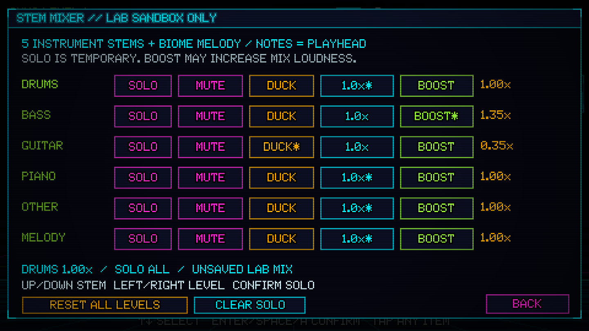
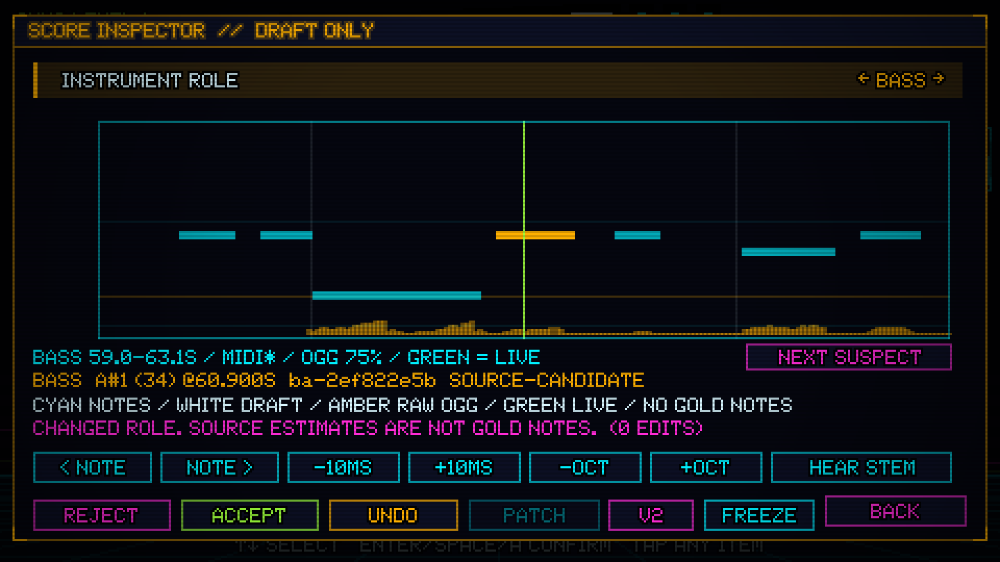

# Music Lab: original OGG waveform + provisional note roll + independent stem mixer

**Date:** November 18, 2026.  **Branch:** `feature/music-lab-visual-mixer-20261118`. **Status:** independently implemented music research UI, NOT merged to `main`, no deployment or human listening approval yet.

## How to open

From **Settings → Manage Sound → Music Lab**, the bottom strip has `NOTES` and a new `MIXER` button next to it. The Lab still plays the real shipped stem files through an isolated `StemMusicDirector`, sharing the game's WebAudio processing without changing your music settings, original OGGs or game saves.

The **Mixer** exposes six independently controllable **audition roles**: **drums, bass, guitar, piano, other, and biome melody**. The five instrumental roles use the original source stems unless your Lab replacement setting routes the corresponding audition to the existing adaptive instruments; the melody role selects the current biome lead. The separate original `vocals` stem remains disabled in the Lab by design, so this is *six audible research roles*, not an unlock-bypass for vocal recordings.

Each row has `SOLO` and the four presets below. Clicking a preset changes only that role; `SOLO` temporarily silences the others **without destroying their individual presets**. Pressing the same Solo again restores the mix. `RESET ALL LEVELS` returns every role to normal and clears solo. Pointer and keyboard/gamepad action handling are both wired: Up/Down selects the role, Left/Right cycles levels, Confirm or Alt toggles solo, Cancel closes.

| Preset | Gain | Meaning |
| --- | ---: | --- |
| MUTE | `0.00x` | Silence only this source role |
| DUCK | `0.35x` | Reduce this stem under the other roles |
| NORMAL | `1.00x` | Keep its source/user-level reference |
| BOOST | `1.35x` | Make this role stand out for comparison |

The mixer uses the game's existing **source input gain**, not its separate motion-speed/airborne automation gain. Adaptive replacement source-level gains are synchronized using `StemMusicDirector.setStemGain`. It does not start a second player, alter source playback speed, or switch the main player's current song. The active solo and gains persist only while the Lab view is open, even while you change the song or biome. **Closing the Lab discards them**; no profile/localStorage writes, game settings updates, uploaded mixes, or file edits are performed.

**Headroom caveat:** boosting many roles can increase the test mix's peak level. This first version has preset gain limits but is *not* a mastering/true-peak safety certification. Consider lower master volume when experimenting with multiple boosts; the test is a comparative research aid, not a recommended production music mix.

## What the Notes view shows

The existing **Score Inspector** already draws detector-produced note candidates (MIDI-like bars) on a **four-second rolling source-frame timeline**. It now overlays a low-profile **amber waveform strip** derived from the **actual decoded original OGG AudioBuffer** of the selected instrument, using the already-present sandbox playback cache. There is **no MIDI playback being synthesized** from these note estimates: the game is auditioning real stems and optionally its separate adaptive instrument alternatives. The source score includes proposed timing, pitch and drum classes, but **neither the base score nor the experimental V2 is human-certified or a final MIDI transcription**.

The visual key is **cyan for provisional base notes**, **pink for optional experimental V2 notes**, **white for draft corrections**, **amber for original-source OGG waveform** (and selected note), and **green for the actual WebAudio playhead**. `OGG 100%` means all 204 display bins in the four-second viewport were represented by already-decoded original audio; lower percentages show partial decoder-cache coverage. Missing samples **are not filled with guessed waveforms**. The waveform is a bounded, sparsely sampled peak envelope, not full-resolution audio and **not** the processed/post-FX/amplified sound you hear. Replacement orchestration can differ from the original waveform; the overlay remains explicitly source-side evidence.

Switch roles in the top of Score Inspector. The instrument selector and note/waveform view now update together. The original `HEAR STEM`, `NEXT SUSPECT`, draft edit, and export controls still work, and notes stay associated with the exact song and immutable performance-score hash. The waveform does not authorize new score notes, beat grids, or timing claims.

## QA and compatibility

- Real WebAudio+original-OGG **Chromium** `tools/music/smoke-lab-waveform-mixer-game.mjs`: mouse-open mixer, Duck to `.35x`, Boost to `1.35x`, Solo, keyboard controls, Mute, Reset, original music director levels untouched, followed by real original OGG waveform + correctly source-bound score overlay. No game profile writes.
- Actual browser UI screenshots captured from the same running build by `tools/music/capture-lab-visual-mixer.mjs`: six-role mixer; bass provisional note bars with real 48k-source-time OGG waveform below. These screenshots do not prove the quality of the underlying detected note transcription.
- `tests/src/music-lab-stem-mix.test.js`: independent per-role gains and solo without losing saved Lab presets, role/melody mix, bounded levels, no live director changes.
- `tests/src/music-lab-source-waveform.test.js`: exact source-to-buffer sample-rate translation, stereo amplitude, across-segment boundaries, partial decode, invalid parameter fail-closed behavior.
- Existing music browser regressions `smoke-score-inspector-game.mjs`, `smoke-score-inspector-pause.mjs`, `smoke-performance-score-game.mjs`, and `smoke-in-game-sound-lab.mjs` remain necessary. The score-inspector mouse locator was updated for the new fifth Lab footer button; draft patch schema and exports are unchanged.

**Engineering ownership:** Music Friday owns this isolated feature branch and its pure music/UI Lab changes, while Control Friday owns gameplay integration. Do **not** merge it into Control Friday's manual pause or Gym branches without coordinating that separate integration. The later published vinyl pause music feature `8cc95fc` remains on its own branch and is untouched. The proposed crash scratch/drum count-in remains an **unimplemented** design discussion; this Lab UI doesn't add it.
